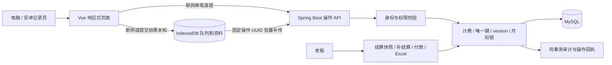

# 实现结构

## 2026-10-18 当前调整

当前优先规则见 [流程调整](confirmed-changes-20261018.md) 和 [付款决策](adr/0003-payment-confirms-worker-current-ledger.md)。每日派工已退役，保留历史表但拒绝新操作；不再加入客户端自动同步。

Flyway V5新增 `gross_weight`、`weight_preset_revision` 及筐型版本字段。新扣皮输入绑定毛重、单筐重配置的历史版本，服务端核验并重算；旧协议可继续补传，选项后续变化不回写历史输入。

`PagedQueries` 为页面提供查询分页读模型：持久明细使用SQL筛选、稳定排序和LIMIT/OFFSET，记录ID分页后才展开计价详情；工资、每日核对及成本按业务口径计算后返回匹配页。`DataList` 统一处理查询、重置、页大小、页码、迟到响应丢弃及离线本机范围，切换查询时清除旧页。

工资页面应发取当前核算，未付取当前核算减累计付款。`Payroll.pay` 在月份锁内检查幂等回执、重新核算、检查余额，仅为目标工人生成差额快照并保存付款和审计；失败整笔回滚。内部历史确认金额仍用于对账，旧快照不可改写。

正式构建预缓存应用外壳；开发入口启用Service Worker，另准备模块资源，排除API及无关失败资源，并处理开发服务响应的Vary差异。页面缓存与账号隔离的IndexedDB业务缓存分离。打印、导出仍以全部匹配数据为范围，不以当前页替代完整账目。

Spring Boot 模块化单体，JdbcTemplate 明确控制唯一约束、版本条件和月份锁，MySQL InnoDB 持久化；Vue 3 同源调用 API，Dexie/IndexedDB 保存离线队列，Workbox 缓存页面外壳，API 不进入页面静态缓存。角色鉴权在服务端实施。



## 领域表

| 表 | 用途 |
| --- | --- |
| farm_user / auth_session | 账号、角色、BCrypt 密码、摘要令牌及有效期 |
| worker | 独立于账号的工人资料，工号唯一 |
| category / product | 类别与具体产品，不含类别规则继承 |
| price_rule | 产品规则 JSON、适用日期窗口、单调递增发布序号 |
| harvest_record | 工人/日期/时段/产品业务唯一；输入、说明、录入人、修改人、version、逻辑删除 |
| ledger_month | 月度行锁和确认状态 |
| operation_receipt | 操作 UUID 唯一、账号、请求内容摘要、原结果 |
| settlement / settlement_line | 月结或补结算批次、差额、记录快照 |
| payment | 付款 ID 唯一、线下付款方式和金额 |
| audit_log | 行为、操作人、前后值和原因 |

## 乐观锁

```sql
UPDATE harvest_record
SET inputs_json = ?, updated_by = ?, version = version + 1,
    updated_at = CURRENT_TIMESTAMP
WHERE id = ? AND version = ?;
```

读取最新值用于核对，并不意味着后续更新无需校验。重提交仍使用最新读取的 version，若有人再次更新，则再次冲突。结算状态、日期权限和恢复/删除状态在每次请求重新校验。

## 事务与本机确认

服务端先声明操作回执、加产品/月份锁，再处理业务；成功业务写入与审计、回执一起提交。相同操作 ID 的不同内容拒绝，相同内容返回原结果。响应丢失不等于失败，客户端保留同一操作重试。

客户端只有在接收明确结果、并将服务端记录写入本机缓存后，才删除对应待传操作，两者在同一 IndexedDB 事务内完成。冲突项保留原输入；提交解决方案时，新操作写入和旧冲突项移除也是同一本机事务。多标签同步由 Web Locks 协调，服务端幂等仍是最终保障。

## 在线提交与逐记录结算保护

在线单笔请求使用 `POST /api/records/operate`，离线积压补传使用 `POST /api/sync`，两者均调用 `Ledger.apply`，共享固定 UUID 回执、权限、版本与审计事务。在线提交期间保留本机发送凭据（sending），不显示在待同步队列，也不会被普通同步任务发送；明确成功后缓存回执并删除凭据，明确拒绝则保留表单并删除凭据，连接失败或结果未知才转 pending。页面重开会把中断的 sending 恢复为 pending，使用原 ID 查明结果。多标签偶发重传由服务端幂等保证不重复执行。

结算保护以 `settlement_line` 是否存在该 `record_id` 的快照为准，不能通过累计金额是否非零判断，也不使用 `ledger_month.closed` 锁住全月。业务事务显式使用 READ COMMITTED，避免 MySQL 默认可重复读让等待月份锁后的检查沿用旧快照。月份行锁仍用于使结算与删除互斥：先结算则拒绝删除，先删除则不计入后续结算。已结算记录不能被任何角色直接删除；管理员更正仍保留原结算快照及审计，差额进入补结算。

## 本地环境

独立 MySQL 数据目录 `.local/mysql-data`，端口 13316，避免复用现有数据库。测试使用内存库或专用 `harvest_test`。页面通过 Vite preview 提供静态产物与同源 API 代理，适合本地演示；没有把开发服务器宣传为公网生产部署。

## 月度工作量与工资聚合

计价器按实际作业日期选择产品规则，计算每条记录的组合阶段、重量换算和逐条四舍五入金额。工资预览将这些当前计价结果绑定为 SQL 派生表，与 `harvest_record`、`worker` 关联并限制月份，再以 `GROUP BY r.worker_id,w.name,w.code` 和 `SUM` 汇总计件总筐数、计重总公斤数、当前应发与已确认金额。应用层只做逐条计价和汇总后的差额计算，不再用 Java Map 按工人累加。派生表不持久化，避免追溯规则变化后旧缓存金额与当前工资不一致。工资页面、结算及 Excel 导出共用该汇总入口。


## 2026-10-17 功能扩展

Flyway V4 增加 farm_plot、record_plot、dispatch_plan、dispatch_receipt、import_batch 和 daily_print_snapshot。record_plot 保存班组和地块共同数量组成；record_group 保留为原班组聚合及签字核对视图。地块移动不改变原 inputs_json 和班组汇总，因此不会仅因地点变化使签字失效。仍按原唯一时段记录计薪，成本最后分摊，见 adr/0001-preserve-period-record-with-group-plot-allocation.md。

Dispatch 使用独立幂等回执、版本校验与审计；客户端派工操作保存在账号前缀隔离的 IndexedDB cache 项中，沿用现有自动同步触发点，在派工页面处理冲突。派工不是采摘量或工资来源。

CatalogImport 解析系统 Excel 模板，预览在回滚事务中验证本批新增、更新和关联创建并保存预览摘要；提交按账号锁定导入批次，在事务内重新校验与对照摘要，任一错误整批回滚，成功结果保存以支持同批重试。不能通过导入系统账号或计费规则越权。

PrintSnapshots 在月份锁内读取核对表并校验工人账目指纹，保存服务端实际生成的内容及模板，页面以响应中的固定版本打印。快照与审计不受之后的数量、价格或模板变化改写。对比限定原表工人范围，涵盖后来补录的记录，保存审计基线以区分同秒内原有操作与后续更正。

Ledger 的历史数量更正权限与财务确认权限分离，见 adr/0002-recorder-history-corrections.md。客户端刷新按请求代次和已确认记录版本防止旧响应覆盖新值。原离线操作可选字段为空时不进入序列化，保留旧操作摘要和编号。
